# Practical 1: Simple Storage Smart Contract

## Aim

To create, compile, deploy and test a Solidity smart contract using Remix IDE, first in Remix JavaScript VM and then on the Sepolia Ethereum testnet.

## Software and Tools

- Remix Desktop IDE
- Remix Web IDE
- Solidity compiler 0.8.20
- Remix JavaScript VM (Osaka)
- MetaMask (wallet created)
- WalletConnect
- Sepolia Ethereum Testnet
- Sepolia Etherscan

## Smart Contract

The contract is named `SimpleStorage.sol`.

It contains:

1. A private uint256 state variable named `number`.
2. A constructor to initialize the number.
3. A `setNumber()` function to update the value.
4. A `getNumber()` view function to retrieve the value.

## Procedure

### Part A: Deployment Using Remix JavaScript VM

1. Open Remix Desktop IDE.
2. Create `SimpleStorage.sol`.
3. Write the Solidity smart contract.
4. Select a compatible Solidity compiler (0.8.20).
5. Compile the contract and check for errors.
6. Select Remix VM as the deployment environment.
7. Deploy the contract with an initial constructor value of 100.
8. Call `setNumber()` with the value 250.
9. Call `getNumber()` to verify the updated value.

### Part B: Deployment Using Sepolia Testnet

1. Open Remix Web IDE.
2. Connect MetaMask using WalletConnect.
3. Select the Sepolia test network.
4. Ensure the wallet has sufficient Sepolia test ETH.
5. Upload and compile `SimpleStorage.sol`.
6. Deploy the contract with an initial constructor value of 100.
7. Confirm the deployment transaction in MetaMask.
8. Verify the deployed contract and its address on Sepolia Etherscan.
9. Attach Remix to the deployed contract using its address.
10. Call `getNumber()` and verify the initial value is 100.
11. Call `setNumber()` with the value 250 and confirm the transaction.
12. Call `getNumber()` again and verify that the updated value is 250.

## Observations and Results

### Remix JavaScript VM

| Operation | Input | Result |
|---|---:|---|
| Constructor | 100 | Initial value stored |
| setNumber() | 250 | Value updated |
| getNumber() | None | 250 |

### Sepolia Testnet

| Operation | Input | Result |
|---|---:|---|
| Contract deployment | 100 | Successful |
| getNumber() | None | 100 |
| setNumber() | 250 | Successful |
| getNumber() | None | 250 |

## Transaction Details

### Remix JavaScript VM

- Deployment constructor argument: 100 (hexadecimal: `0x64`).
- `setNumber()` transaction argument: 250 (hexadecimal: `0xfa`).
- `getNumber()` returned: 250.
- Network: Remix JavaScript VM (Osaka).
- Transaction hashes: Not recorded.

**Verification:** The deployment and update transactions were successful on Sepolia Etherscan. The final `getNumber()` call returned 250.

## Screenshots

All screenshots are stored in `screenshots/simple-storage/`.

### A. Remix VM Deployment and Testing

**1. Solidity Source Code**

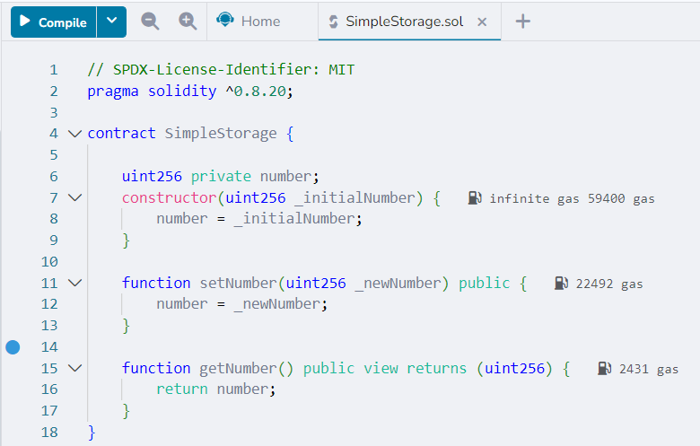

**2. Successful Compilation**

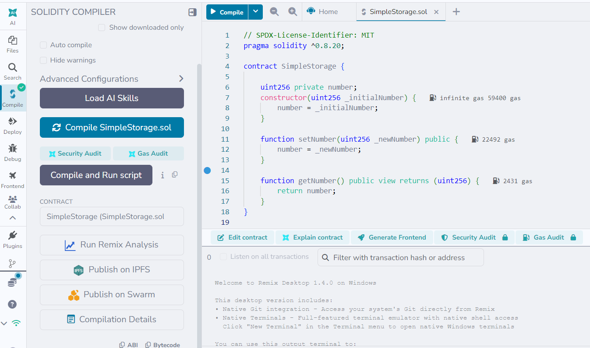

**3. Contract Deployment**

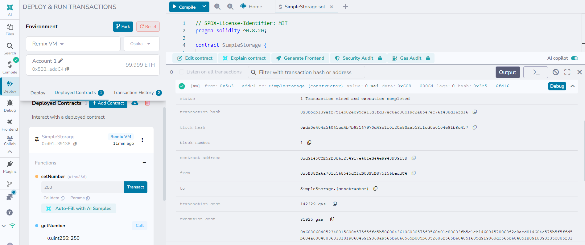

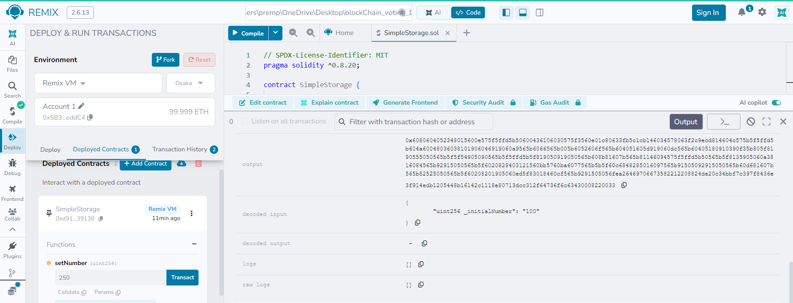

**4. Contract Testing**

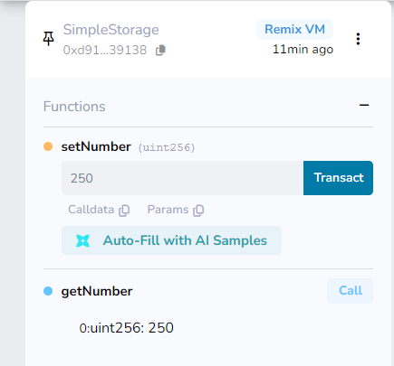

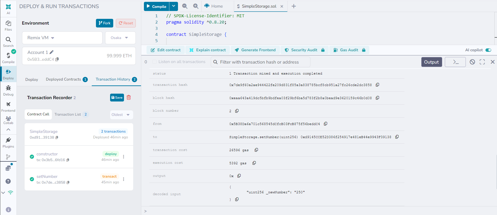

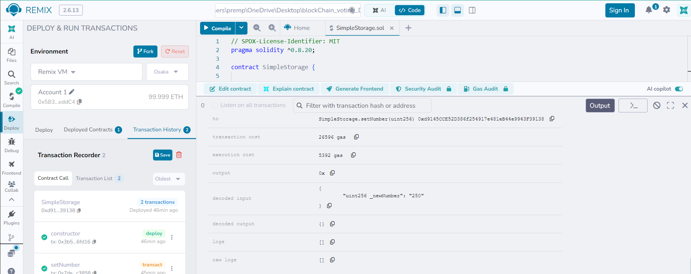

**5. Transaction Evidence**

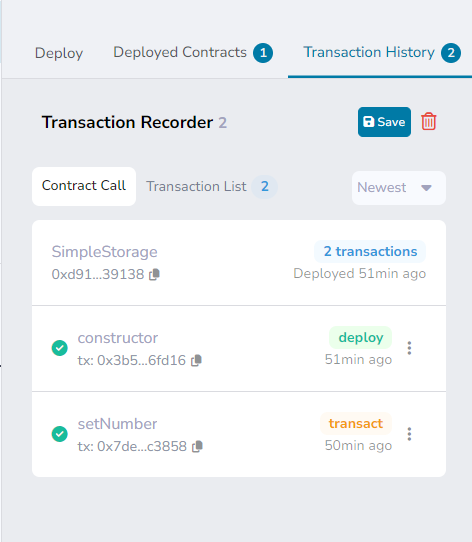

### B. Sepolia Testnet Deployment and Testing

**1. Contract Deployment**

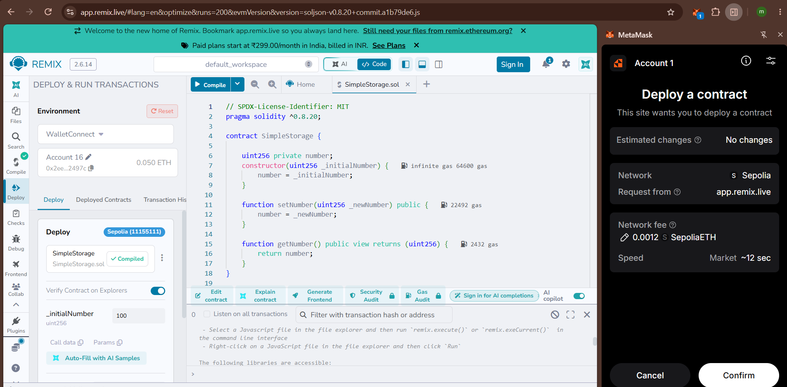

**2. Deployment Transaction Evidence**

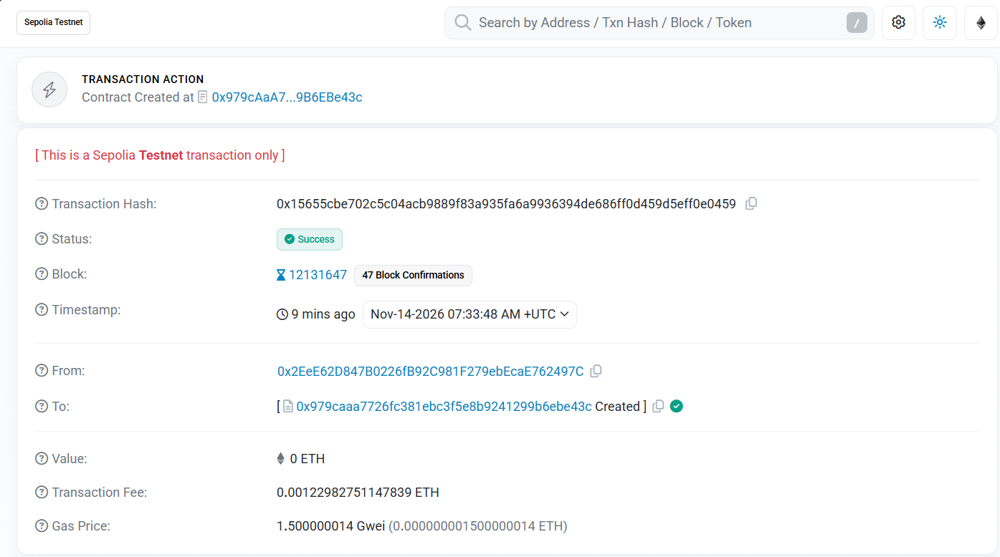

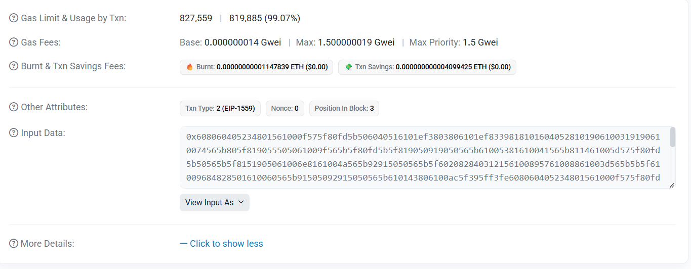

**3. Contract Testing**

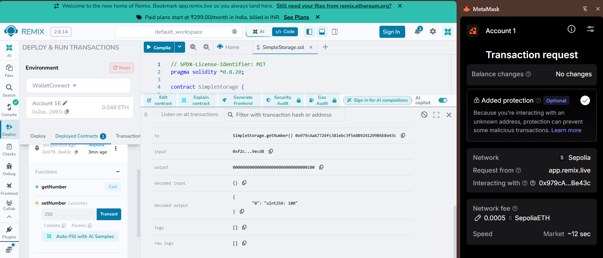

**4. Testing Transaction Evidence**

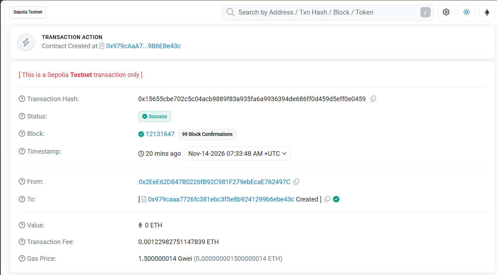

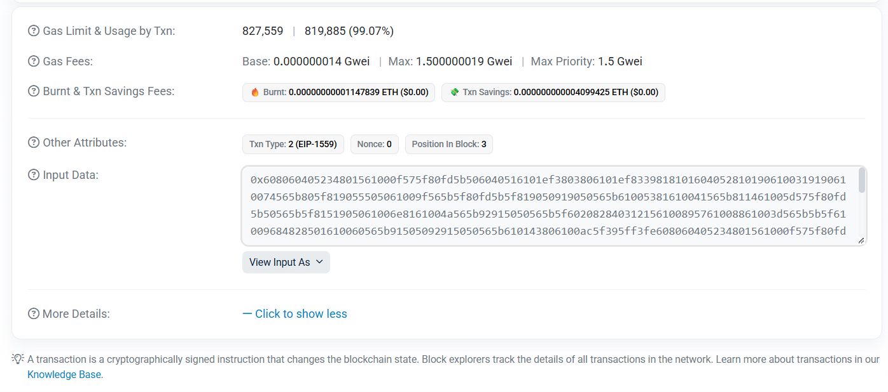

**5. Sepolia Transaction History**

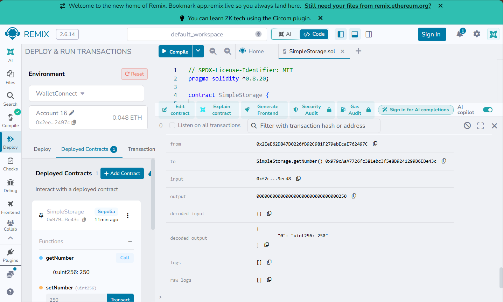

## Conclusion

The SimpleStorage smart contract was successfully compiled, deployed and tested using Remix JavaScript VM and the Sepolia Ethereum testnet.

The `setNumber()` function successfully updated the stored value from 100 to 250, and `getNumber()` returned 250 in both environments. The Sepolia deployment and transaction records were also verified using Etherscan.