# Practical 2: Decentralized Voting Smart Contract

## Objective

To develop and test a decentralized voting smart contract using Solidity. The contract allows users to view candidates, cast votes, prevents an address from voting more than once, and records successful votes through blockchain events.

## Tools and Technologies

- **Solidity:** Smart contract programming language
- **Remix IDE:** Writing, compiling, deploying, and testing the contract
- **Remix VM (Osaka):** Local blockchain environment for testing

## Implementation

The smart contract is implemented in `contracts/Voting.sol`.

It uses a `Candidate` structure to store each candidate's ID, name, and vote count. Three candidates are initialized when the contract is deployed:

- Candidate A
- Candidate B
- Candidate C

A mapping tracks whether an Ethereum address has already voted.

### Main Functions

| Function | Description |
|---|---|
| `vote(uint256 candidateId)` | Casts a vote for a valid candidate |
| `getCandidate(uint256 candidateId)` | Retrieves a candidate's ID, name, and vote count |
| `getCandidateCount()` | Returns the total number of candidates |
| `hasVoted(address voter)` | Checks whether an address has already voted |

### Voting Rules

1. Only valid candidate IDs can receive votes.
2. Each Ethereum address can vote only once.
3. A successful vote increments the selected candidate's vote count.
4. An unsuccessful transaction does not change the voting state.
5. The `VoteCast` event is emitted after a successful vote.

## Compilation and Deployment

The contract was compiled successfully in Remix IDE and deployed using the Remix VM environment.

The deployed contract exposed all four functions for interaction and testing.

## Testing and Results

The following functionality was tested:

| Test | Result |
|---|---|
| Candidate count retrieval | Passed |
| Candidate details retrieval | Passed |
| Successful vote for Candidate A | Passed |
| Successful vote for Candidate B using another account | Passed |
| Duplicate-vote prevention | Passed |
| Invalid candidate ID rejection | Tested |
| `VoteCast` event verification | Passed |

The successful voting transaction for Candidate B emitted the `VoteCast` event with the voter address, candidate ID, and candidate name.

During testing, Candidate A's vote count reached 2 and Candidate B's vote count reached 1.

## Screenshots

### 1. Smart Contract Source Code

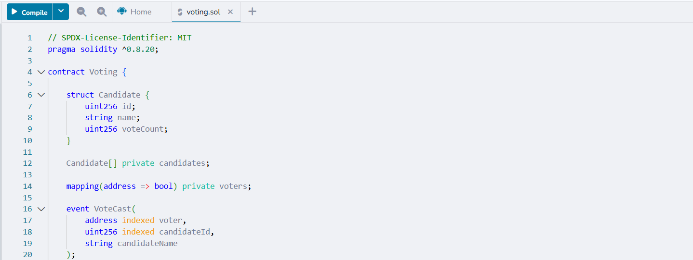

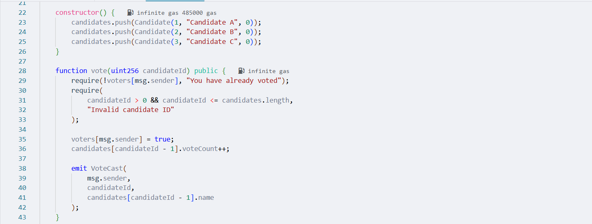

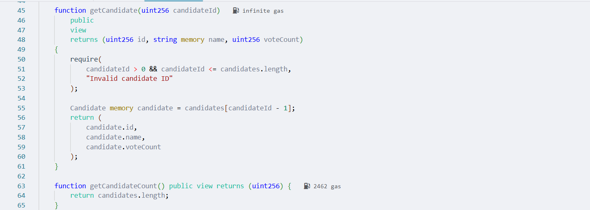

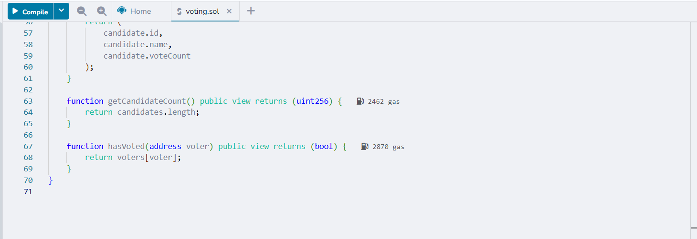

### 2. Compilation

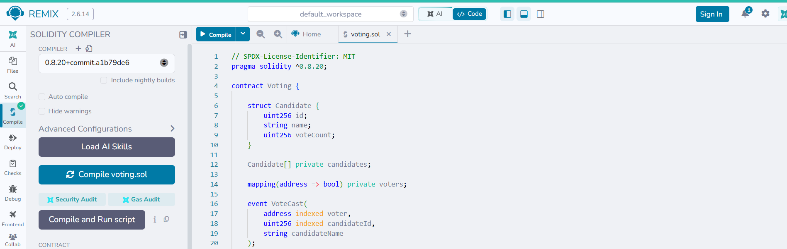

### 3. Candidate Information

**Candidate A**

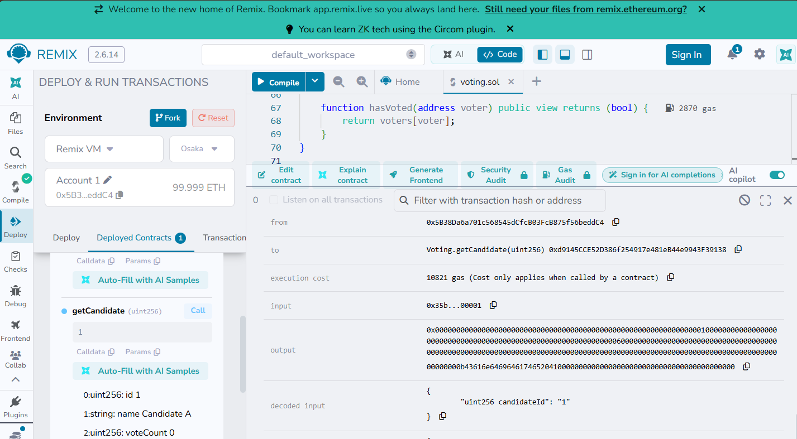

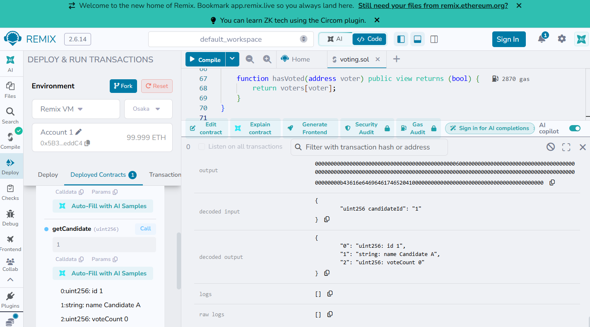

**Candidate B**

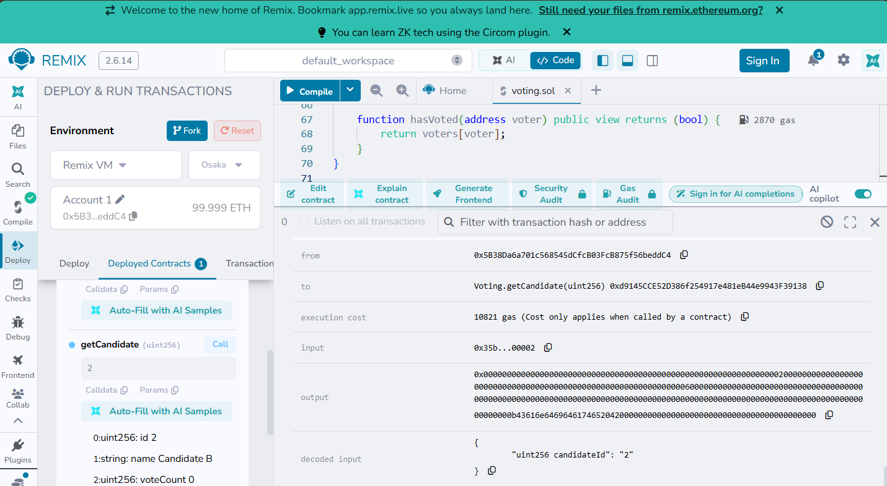

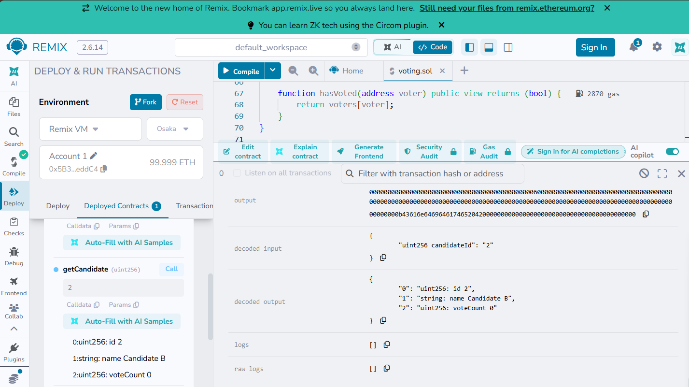

**Candidate C**

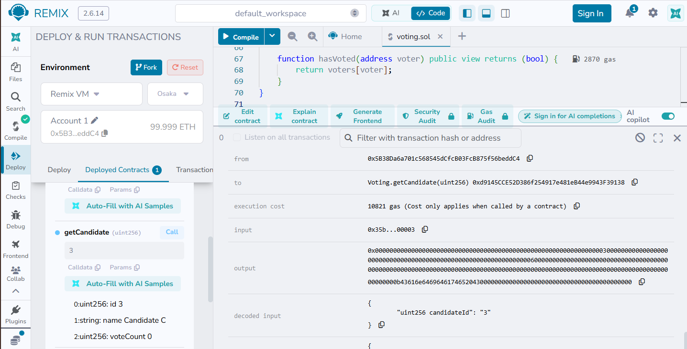

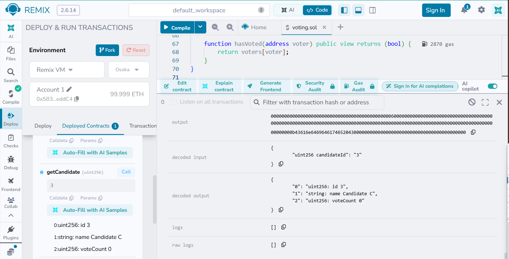

### 4. Voting Tests

**Successful Voting**

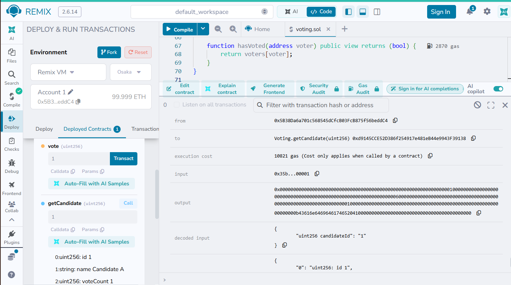

**Duplicate-Vote Prevention**

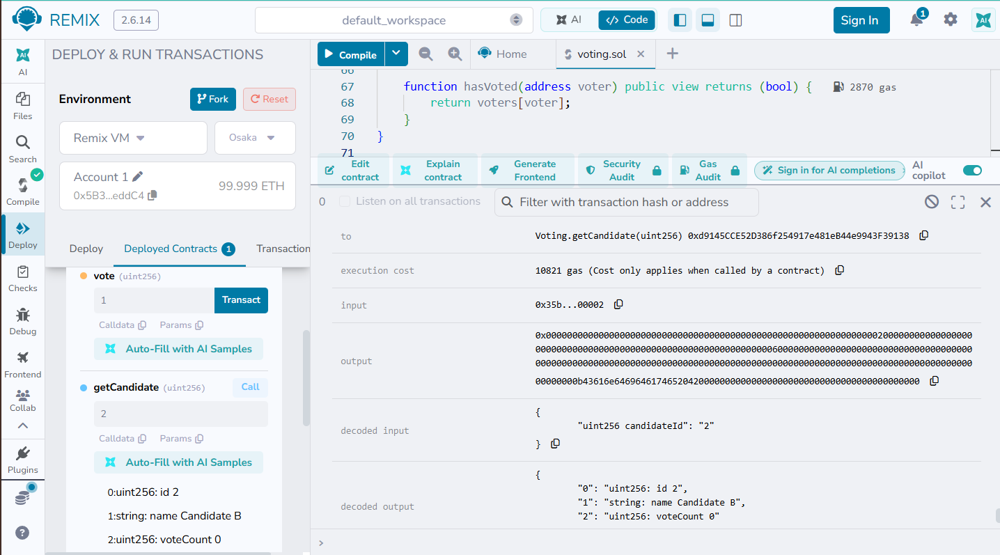

**Invalid Candidate ID Rejection**

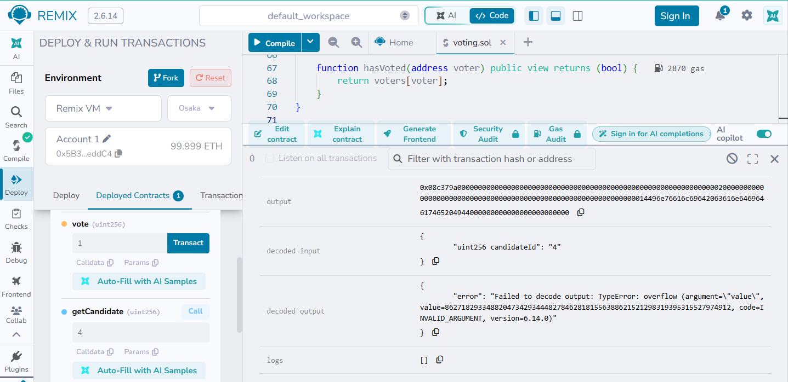

## Conclusion

The decentralized voting smart contract was successfully implemented, compiled, deployed, and tested in Remix VM. The practical demonstrates candidate management, vote recording, one-vote-per-address enforcement, invalid candidate validation, and event emission through Solidity.