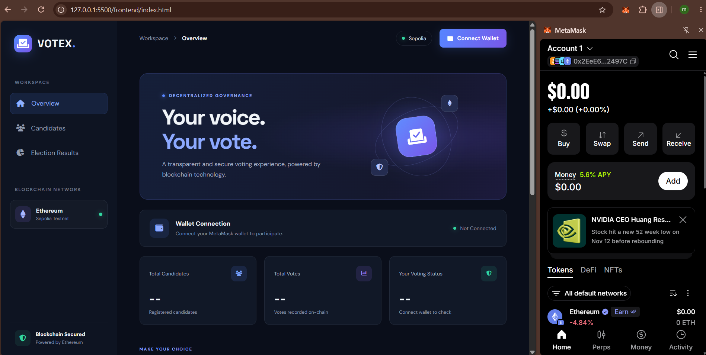
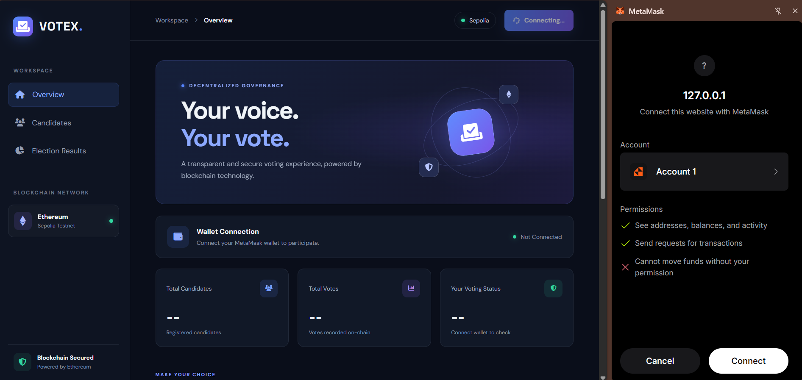
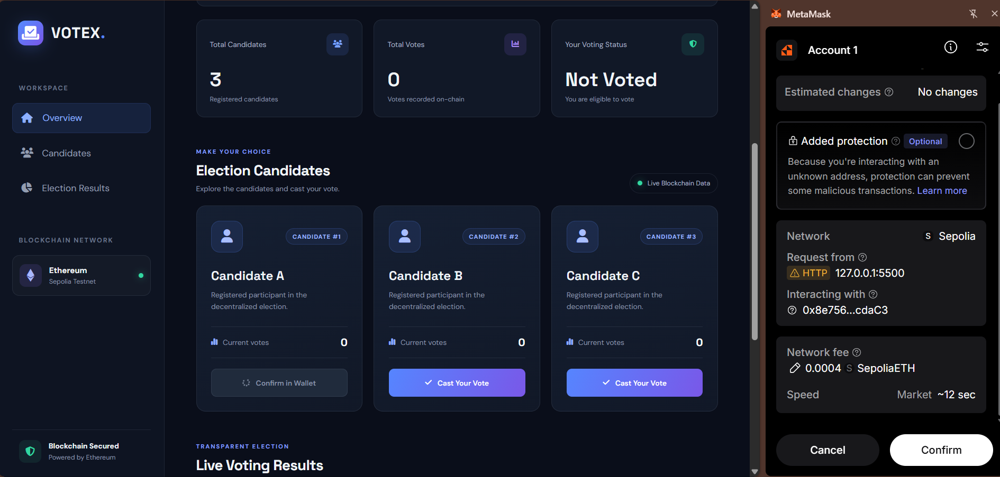
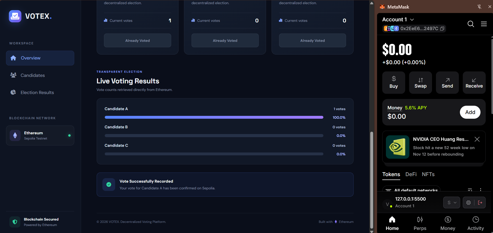
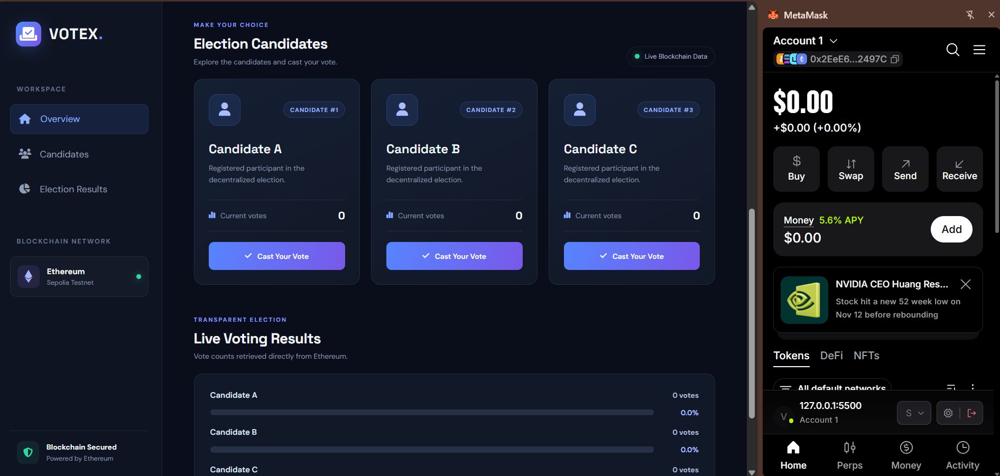

# Practical 3: Decentralized Voting DApp — Frontend Development and Integration

## Aim
To design and develop a professional web-based frontend for the Decentralized Voting System and integrate it with the deployed Solidity smart contract using MetaMask and ethers.js.

## Software and Tools
- Visual Studio Code
- HTML5
- CSS3
- JavaScript
- ethers.js v6
- MetaMask Browser Extension
- Remix IDE
- Sepolia Ethereum Testnet
- VS Code Live Server
- Git and GitHub

## Project Overview
This practical focuses on developing a professional frontend for the Decentralized Voting System created in Practical 2.

The application, named **VOTEX**, provides a web-based interface through which users can connect their Ethereum wallets, view election candidates, check voting statistics, and cast votes directly through the deployed smart contract.

The frontend communicates with the Ethereum blockchain using ethers.js and MetaMask, allowing users to interact with the decentralized application without directly using the Remix IDE.

## Features Implemented

1. **Professional User Interface:** Designed a modern dashboard with candidate cards, election statistics, and voting results.
2. **Wallet Connection:** Integrated MetaMask to connect Ethereum accounts with the application.
3. **Network Detection:** Implemented Sepolia network validation to ensure interaction with the correct blockchain network.
4. **Candidate Information:** Retrieved candidate IDs, names, and vote counts directly from the deployed smart contract.
5. **Voting Functionality:** Enabled users to cast votes by submitting blockchain transactions through MetaMask.
6. **Voting Status:** Checked whether the connected wallet had already participated in the election.
7. **Duplicate Vote Prevention:** Integrated the smart contract's voting restrictions with the frontend.
8. **Live Results:** Refreshed candidate vote counts after successful transaction confirmation.
9. **Transaction Feedback:** Displayed transaction status and notifications during the voting process.
10. **Error Handling:** Implemented handling for unavailable wallets, network mismatches, rejected transactions, and failed transactions.

## Technologies Used

| Technology | Purpose |
|---|---|
| HTML5 | Frontend structure |
| CSS3 | Interface design and styling |
| JavaScript | Application logic |
| ethers.js v6 | Ethereum blockchain interaction |
| MetaMask | Wallet connection and transaction signing |
| Solidity | Smart contract implementation |
| Remix IDE | Contract compilation and deployment |
| Sepolia | Ethereum test network |
| VS Code Live Server | Local frontend development and testing |
| Git and GitHub | Version control and project hosting |

## Implementation

### 1. Frontend Development
Created a separate `frontend` directory containing the main HTML page, CSS stylesheet, and JavaScript files.

The interface was designed to provide an organized dashboard for displaying election information, candidate details, voting controls, and election results.

### 2. Smart Contract Configuration
Configured the deployed Voting smart contract's address, Sepolia chain ID, and required ABI functions in `contract.js`.

The ABI provides the frontend with access to the smart contract functions required for retrieving candidate information, checking voting eligibility, and submitting votes.

### 3. Wallet Integration
Integrated MetaMask using ethers.js and the browser's injected Ethereum provider.

The application allows users to connect their Ethereum accounts and checks the active blockchain network before interacting with the smart contract.

### 4. Candidate Data Retrieval
Implemented blockchain read operations using the following smart contract functions:

- `getCandidateCount()` – Retrieves the total number of candidates.
- `getCandidate()` – Retrieves candidate information and vote counts.
- `hasVoted()` – Checks whether a wallet has already voted.

The retrieved information is dynamically displayed on the dashboard.

### 5. Vote Submission
Integrated the smart contract's `vote()` function to allow users to cast their votes through MetaMask.

The application requests transaction approval from the connected wallet, submits the transaction to the Sepolia network, and waits for transaction confirmation.

### 6. Voting Eligibility and Duplicate Prevention
Implemented voting status verification using the `hasVoted()` function.

After a successful vote, the application refreshes the election data and updates the interface to indicate that the connected wallet has already voted.

The smart contract independently enforces the one-vote-per-wallet restriction.

### 7. Election Results
Implemented dynamic result displays to show candidate vote counts and updated voting statistics retrieved from the blockchain.

The dashboard refreshes the displayed results after successful transaction confirmation.

### 8. Error Handling
Implemented application-level error handling for common situations, including:

- MetaMask not installed or unavailable.
- Wallet connection rejection.
- Incorrect blockchain network.
- Transaction rejection by the user.
- Failed blockchain transactions.

## Screenshots

### 1. VOTEX Dashboard

Displays the professional frontend dashboard, including election statistics and candidate information.

### 2. MetaMask Wallet Connection

Demonstrates successful wallet connection and the detected Sepolia network.

### 3. Successful Voting Transaction

Shows the successful voting process and transaction confirmation.

### 4. Updated Election Results

Displays updated candidate vote counts and the already-voted status after successful transaction confirmation.

### 5. Candidate Information

Displays the candidate cards and information retrieved from the deployed smart contract.

## Testing and Verification

The frontend was launched locally using VS Code Live Server and tested with MetaMask on the Sepolia Ethereum Testnet.

The following test cases were successfully completed:

| Test Case | Expected Outcome | Result |
|---|---|---|
| Website launch | Dashboard loads successfully | Successful |
| MetaMask connection | Wallet connects to the application | Successful |
| Network detection | Sepolia network is detected | Successful |
| Candidate retrieval | Candidate information is displayed | Successful |
| Voting transaction | Vote is submitted through MetaMask | Successful |
| Transaction confirmation | Transaction is confirmed | Successful |
| Results update | Candidate vote count is refreshed | Successful |
| Voting status | Wallet is marked as already voted | Successful |
| Duplicate vote prevention | Further voting is restricted | Verified |

## Result
Successfully designed and developed **VOTEX**, a professional web-based frontend integrated with the Decentralized Voting smart contract deployed on the Sepolia Ethereum Testnet.

The application successfully demonstrates MetaMask wallet integration, blockchain-based candidate information retrieval, secure vote submission, voting eligibility verification, and dynamic election result updates.

This practical demonstrates the complete integration of Solidity smart contracts with a web-based decentralized application (DApp) using HTML, CSS, JavaScript, ethers.js, and MetaMask.