# Practical 4: Decentralized Voting DApp — Test and Analyse the Voting DApp

## Aim

To test and analyse the Decentralized Voting DApp by performing successful voting, duplicate voting prevention, voting from multiple Ethereum accounts, and invalid candidate ID validation on the Ethereum Sepolia Testnet.

## Software and Tools

- Remix Web IDE
- Solidity 0.8.20
- MetaMask Wallet
- Ethereum Sepolia Testnet
- VOTEX Decentralized Voting DApp
- Blockscout Explorer
- Visual Studio Code
- Live Server Extension
- ethers.js

## Testing Environment

The Voting smart contract was deployed on the Ethereum Sepolia Testnet and integrated with the VOTEX frontend using ethers.js.

The application allows users to connect their Ethereum wallets, view registered candidates, cast votes, and retrieve updated voting results directly from the blockchain.

Three candidates were registered in the smart contract:

| Candidate ID | Candidate Name |
|---|---|
| 1 | Candidate A |
| 2 | Candidate B |
| 3 | Candidate C |

---

## Experiment A: Successful Voting

### Objective

To verify that a connected Ethereum account can successfully vote for a candidate and that the candidate's vote count is updated on-chain.

### Procedure

1. Opened the VOTEX application using Live Server.
2. Connected MetaMask to the Ethereum Sepolia Testnet.
3. Selected Candidate A from the available candidates.
4. Confirmed the voting transaction through MetaMask.
5. Waited for transaction confirmation.
6. Verified the successful voting status on the frontend.
7. Checked the transaction details and gas consumption using Blockscout.

### Observations

- The voting transaction was successfully submitted and confirmed.
- Candidate A's vote count increased by one.
- The frontend displayed a successful voting notification.
- The user's voting status changed to **Already Voted**.
- All candidate voting buttons became disabled for the connected account.

### Transaction Details

**Transaction Verification:** [View Successful Voting Transaction on Blockscout](https://eth-sepolia.blockscout.com/tx/0x2da6ad6aca459951dde7302e0885358f693b388f0b9d08894cec915e33e55e7e)

### Screenshots

**1. Successful voting through the VOTEX frontend**

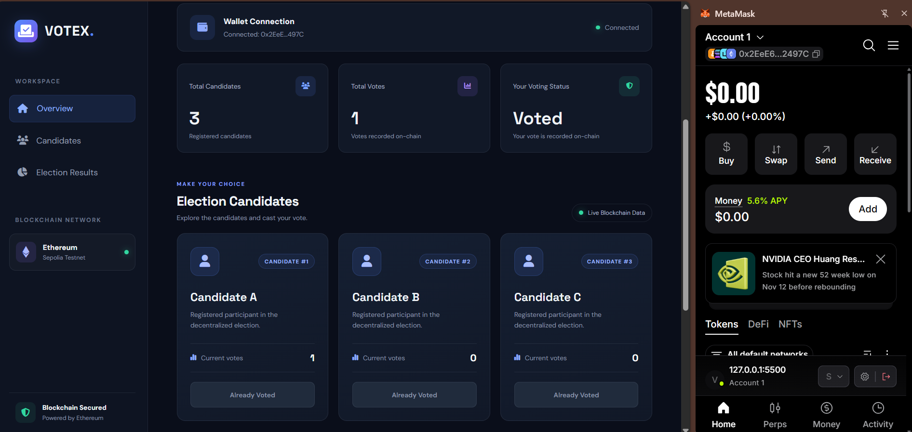

**2. Successful voting transaction hash**

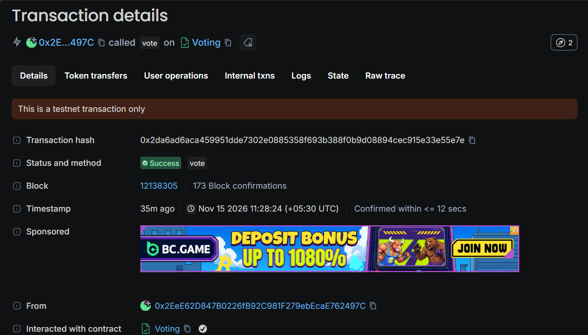

**3. Transaction gas usage and limit**

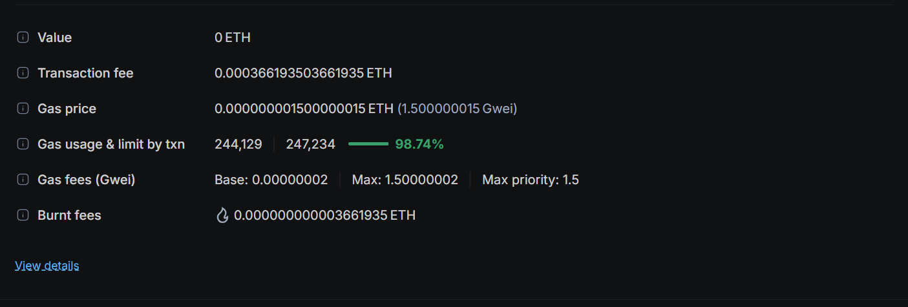

### Result

The successful voting experiment was completed. The transaction was confirmed on the Sepolia Testnet, and Candidate A's vote count was updated correctly.

---

## Experiment B: Duplicate Voting Prevention

### Objective

To verify that an Ethereum account cannot cast more than one vote in the election.

### Procedure

1. Reconnected the original Ethereum account that had already voted.
2. Opened the VOTEX voting dashboard.
3. Observed the voting buttons for all three candidates.
4. Checked the account's voting status through the frontend.
5. Used the `hasVoted(address)` function in Remix to verify the account's voting status on-chain.

### Observations

- All three candidate voting buttons were disabled after the first successful vote.
- The frontend displayed the voting status as **Already Voted**.
- The smart contract's `hasVoted(address)` function returned `true` for the connected account.
- The frontend prevented another voting attempt.

### Screenshots

**1. Voting buttons disabled after the first successful vote**

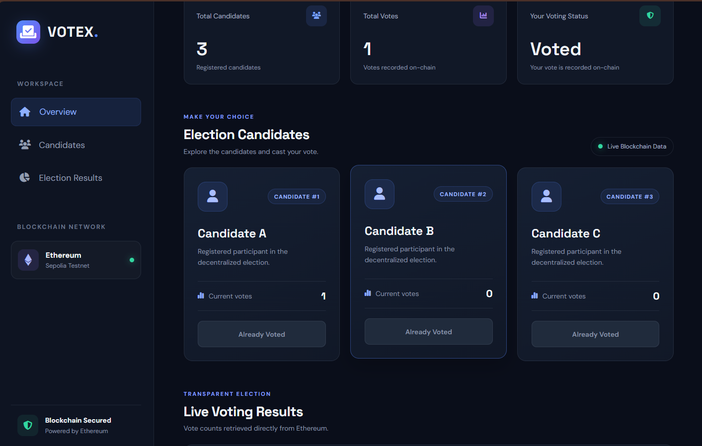

### Result

Duplicate voting prevention was verified. The frontend disabled further voting options, and the smart contract confirmed that the account had already voted.

**Note:** A second transaction was not submitted because the frontend prevented the attempt. The contract's duplicate-voting restriction was independently checked using `hasVoted(address)`. Duplicate-voting rejection was also tested separately using Remix VM.

---

## Experiment C: Voting from Another Ethereum Account

### Objective

To verify that a different Ethereum account, which has not previously voted, can successfully participate in the election.

### Procedure

1. Created a second Ethereum account in MetaMask.
2. Switched MetaMask to the newly created account.
3. Obtained Sepolia test ETH through the Google Cloud Web3 Faucet.
4. Connected the VOTEX application using the second account.
5. Verified that the second account was eligible to vote.
6. Selected Candidate B from the available candidates.
7. Confirmed the voting transaction through MetaMask.
8. Waited for transaction confirmation.
9. Verified the successful voting event and transaction details using Blockscout.
10. Checked the updated voting results on the VOTEX frontend.

### Observations

- The second Ethereum account was successfully connected to VOTEX.
- The frontend recognized the account as eligible to vote.
- Sepolia test ETH was successfully obtained to fund the transaction.
- The second account successfully voted for Candidate B.
- The blockchain recorded the `VoteCast` event.
- The event confirmed that Candidate B received the vote.
- Candidate B's vote count increased by one.

### Transaction Details

**Transaction Verification:** [View Second Voting Transaction on Blockscout](https://eth-sepolia.blockscout.com/tx/0x1d98b18c4ec0394595900963f5e88b08da2cd8b4af0d359e41597206ba21613a)

### Blockchain Event Verification

The `VoteCast` event was verified through Blockscout with the following information:

| Event Field | Recorded Value |
|---|---|
| Event Name | VoteCast |
| Candidate ID | 2 |
| Candidate Name | Candidate B |
| Voter | Second Ethereum Account |

This confirms that the second account successfully cast a vote for Candidate B and that the transaction was recorded on the blockchain.

### Final Voting Results

| Candidate | Votes |
|---|---:|
| Candidate A | 1 |
| Candidate B | 1 |
| Candidate C | 0 |
| **Total Votes** | **2** |

### Screenshots

**1. Second account funded with Sepolia test ETH**

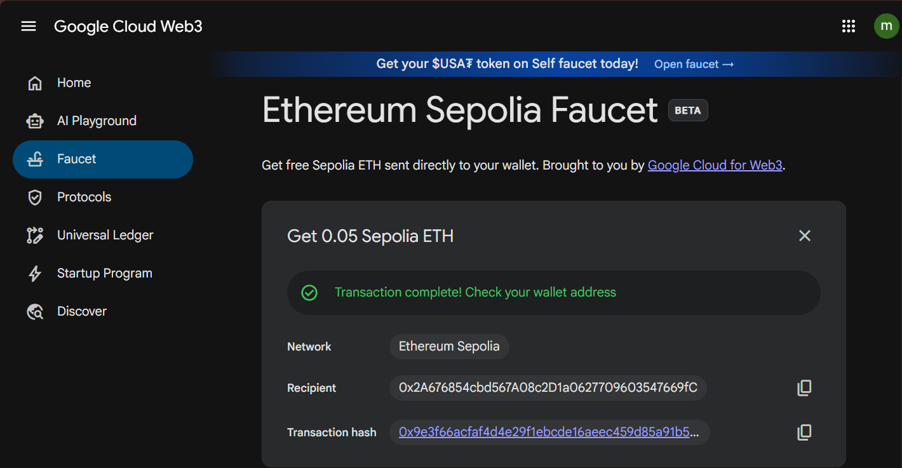

**2. Second account voting through VOTEX**

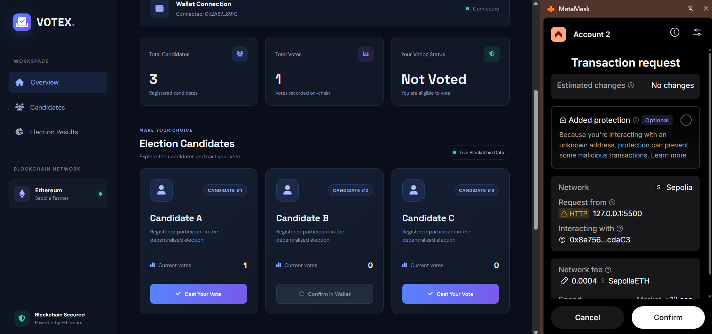

**3. Second account transaction details**

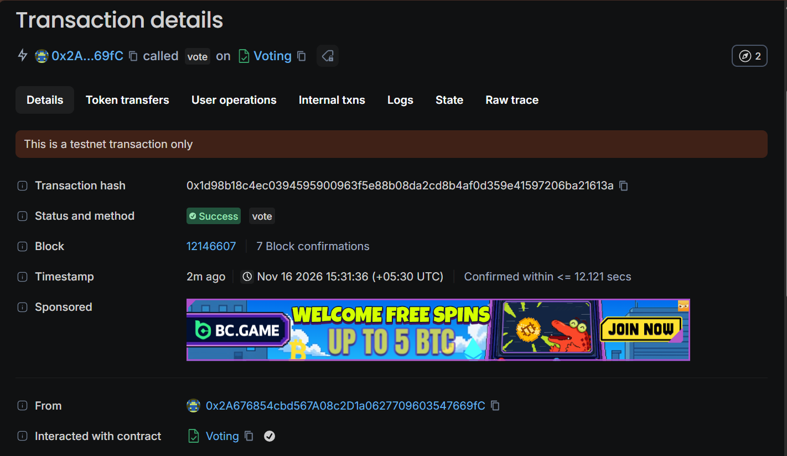

**4. Transaction gas usage and limit**

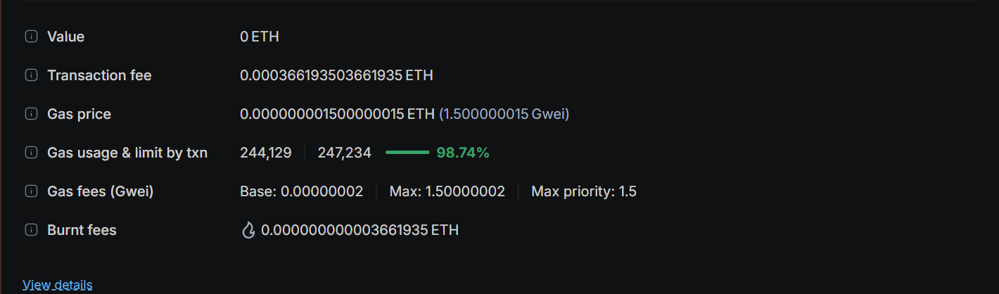

**5. Blockchain voting event evidence**

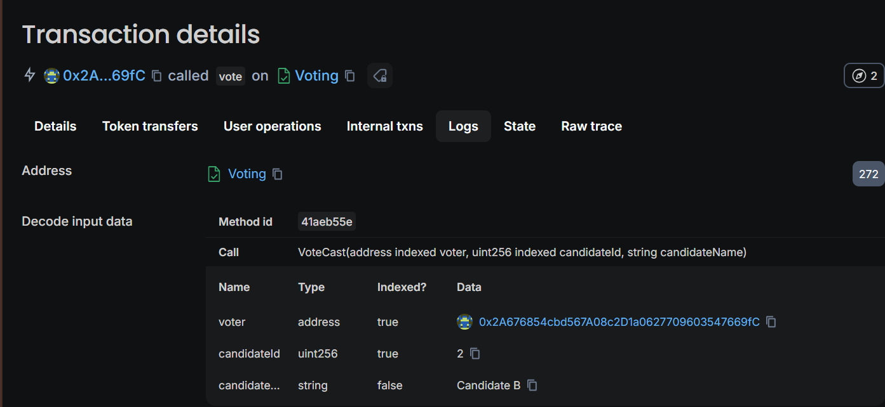

**6. Final updated voting results**

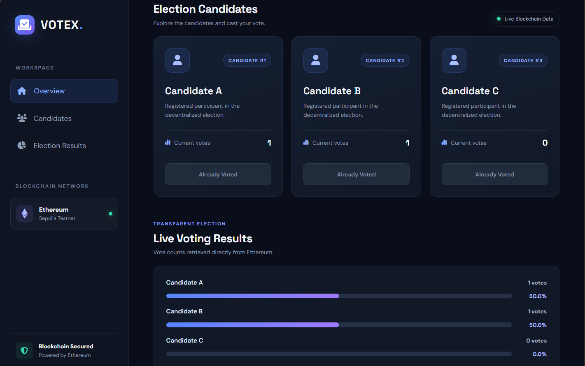

### Result

The experiment was successfully completed. The second Ethereum account independently cast a vote for Candidate B, and the transaction was confirmed on the Sepolia Testnet.

The final voting results showed one vote each for Candidate A and Candidate B, demonstrating that multiple eligible Ethereum accounts can independently participate in the decentralized voting application.

---

## Experiment D: Invalid Candidate ID Validation

### Objective

To verify that the smart contract rejects voting attempts involving a candidate ID that does not exist.

### Procedure

1. Opened Remix Web IDE.
2. Connected Remix to the Ethereum Sepolia Testnet using MetaMask.
3. Restored the existing deployed Voting contract interface using its contract address and ABI.
4. Located the `vote(uint256 candidateId)` function.
5. Entered candidate ID `4`, although only three candidates were registered.
6. Attempted to submit the transaction.
7. Observed MetaMask's transaction simulation warning, which indicated that the transaction would fail.
8. Rejected the transaction and checked the candidate vote counts using `getCandidate(uint256 candidateId)`.

### Observations

- Candidate ID `4` was invalid because the contract contained only three registered candidates.
- MetaMask predicted that the transaction would fail.
- The transaction was rejected before submission.
- The candidate vote counts remained unchanged.

The smart contract contains the following validation condition:

```solidity
require(
    candidateId > 0 && candidateId <= candidates.length,
    "Invalid candidate ID"
);
```

### Screenshots

**1. Invalid candidate ID attempt and transaction failure warning**

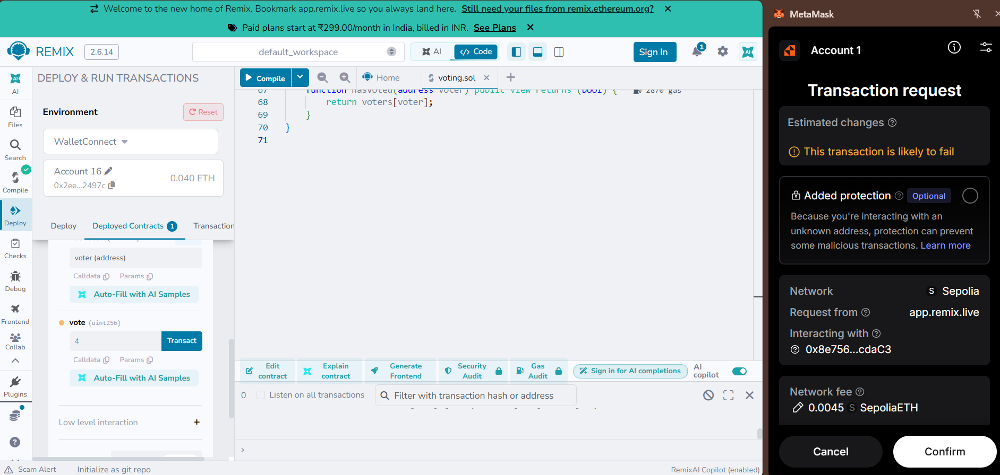

### Vote Count Verification

| Candidate | Votes after validation |
|---|---:|
| Candidate A | 1 |
| Candidate B | 1 |
| Candidate C | 0 |
| **Total Votes** | **2** |

### Result

Invalid candidate ID validation was verified. The contract's validation condition identified candidate ID `4` as invalid, and the existing voting results remained unchanged.

**Note:** MetaMask detected the failure during transaction simulation, and the transaction was rejected before being submitted to the blockchain. Therefore, this was not a mined failed transaction. The vote counts shown here represent the state at the time Experiment D was performed, before Experiment C was completed.

---

## Overall Analysis

The testing experiments demonstrated the following properties of the Decentralized Voting DApp:

1. **Successful Voting:** Eligible accounts can cast votes, and successful transactions update the blockchain state.
2. **Duplicate Voting Prevention:** The smart contract tracks voters and prevents an account from voting more than once.
3. **Multiple Account Support:** Different eligible Ethereum accounts can independently connect to the application and cast votes.
4. **Input Validation:** The smart contract rejects invalid candidate IDs and prevents invalid voting operations.
5. **Blockchain Transparency:** Transactions and voting events can be independently inspected using a public blockchain explorer.

The experiments also demonstrated the integration between the Solidity smart contract, MetaMask wallet, VOTEX frontend, ethers.js, and Ethereum Sepolia Testnet.

## Conclusion

The Decentralized Voting DApp was successfully tested for successful voting, duplicate voting prevention, voting from multiple Ethereum accounts, and invalid candidate ID validation on the Ethereum Sepolia Testnet.

All four experiments were completed. The second-account voting experiment confirmed that multiple eligible users can independently participate in the election, while the smart contract maintains the correct voting records.

The testing confirms that blockchain-based voting operations are recorded through smart contract transactions and that essential validation mechanisms help maintain the integrity, transparency, and reliability of the voting application.